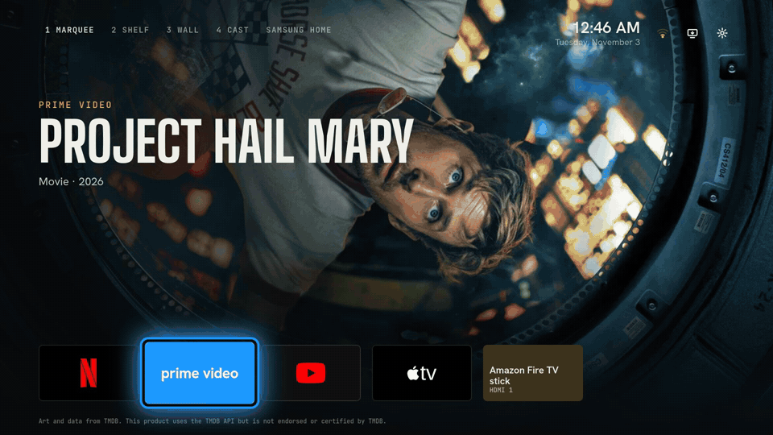
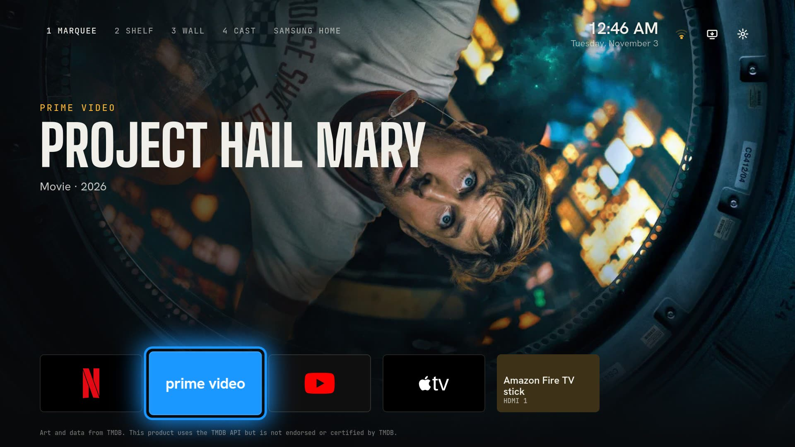
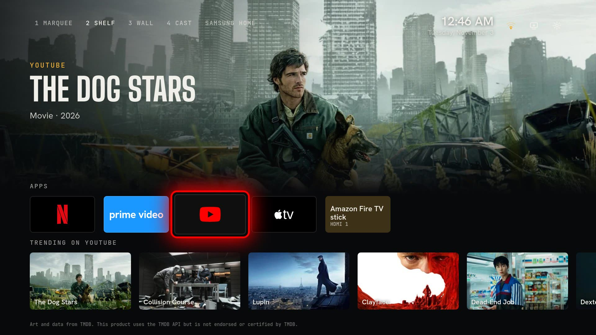
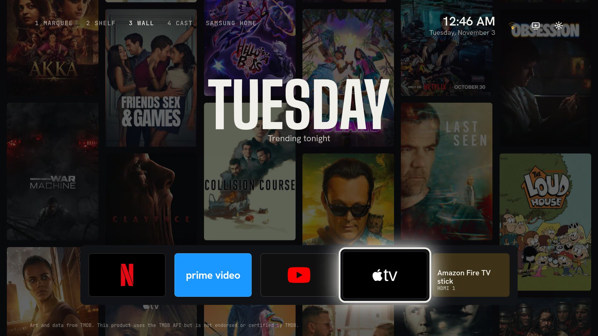
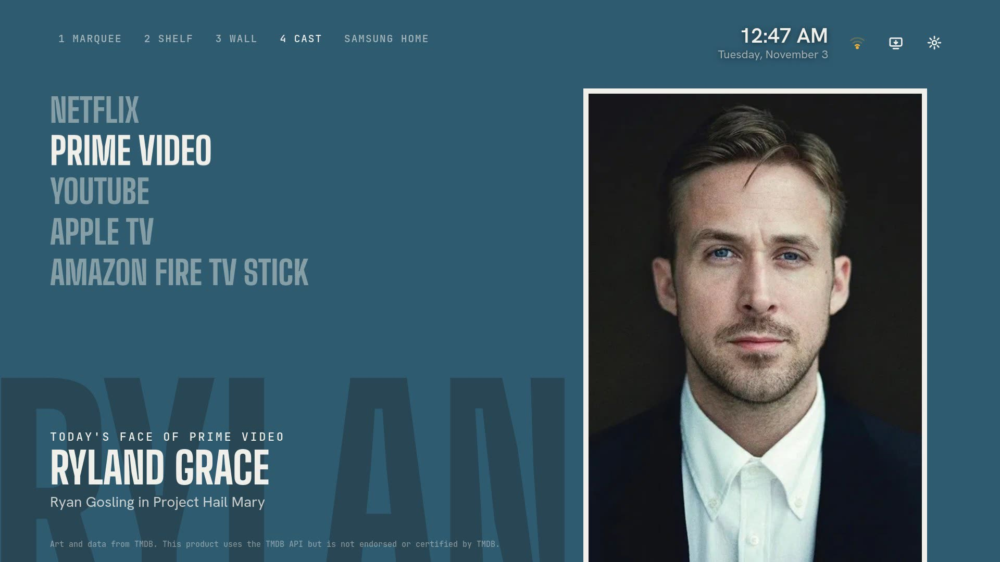

# TV Home

Your Samsung TV's home screen, rebuilt around what is actually on. Every app shows its newest shows full screen, in four looks you switch with the remote. No ad row, no TV Plus, no root.



[Watch the 40 second demo](docs/demo.mp4) (the four looks, then the install). Every TV picture here is a screenshot taken from the TV itself.

## Four looks

| | |
|---|---|
|  |  |
| **1 Marquee.** The app you are on fills the screen with what is new on it, in big cinema titles. | **2 Shelf.** Art on top, your apps, then a row of that service's newest titles. |
|  |  |
| **3 Wall.** Posters from every app scroll behind a dock, with the day in type you read from the couch. | **4 Cast.** Today's face of each app: the lead, their character and the show, on a color field like a magazine cover. |

Press Up on the remote to switch. The TV remembers your pick.

## What it does

- **Art from each service's own shows.** Netflix, Prime Video and Apple TV show their own series that aired in the last 60 days, plus movies released on them in the last year. YouTube and HDMI show what is trending.
- **It keeps changing.** The art moves to the next title every 20 seconds. Each day a different 8 of the top 16 come up. The list is fetched fresh every 12 hours (checked every hour and whenever you come back to Home).
- **Your HDMI device is a tile.** A Fire TV stick or console shows up next to the apps, and selecting it switches input and wakes it over HDMI-CEC.
- **Each tile glows in its app's color** when you land on it.
- **Wi-Fi strength, Inputs and Settings** sit next to the clock.
- **An idle clock.** After 3 minutes without a key press, a big clock over the current show, with a new show every 30 seconds. Any key wakes it.
- **Home comes back here.** The Home button on the remote opens TV Home, and Samsung Home is one press away in the top row.

## What it sends

Only requests to TMDB for art: `api.themoviedb.org` with your own key, and images from `image.tmdb.org`. No analytics, no account, nothing else leaves the TV. The Home-button watcher only talks to the app on `127.0.0.1`.

Without a key, public-domain paintings from the Art Institute of Chicago (CC0) stand in, and nothing is fetched at all.

## Install

Needs [AeroTizen's CLI](https://github.com/helalaou/AeroTizen) with signing certificates made for your TV, and Developer Mode on.

```sh
aerotizen --tv <tv-ip> certs                  # once
echo YOUR_KEY > ~/.config/tv-home/tmdb.key    # optional, a free TMDB "API Key" or "API Read Access Token"
tools/install.sh <tv-ip>                      # build, sign, install and open
```

The install script copies the key into the build in `dist/` only; it is never committed. Only one launcher with a Home watcher should be installed at a time.

## Tested on

Samsung UN65CU7000DXZA (2023), Tizen 8.0. Plain JavaScript and CSS with no build step. Other Tizen TVs are untested; open an issue if yours works or does not.

## Check

```sh
node tools/screens.cjs <path-to-playwright> <out-dir>      # desktop, 1920x1080, all looks
aerotizen --tv <tv-ip> inspect TvHome0001.Home             # then, in another shell:
node tools/tv-check.mjs <out-dir>                           # on the TV: errors, key timing, screenshots
```

## Credits

- `app/service/` is the Home-button watcher from AeroTizen 2.5.0 by Hamza El Alaoui, MIT (`app/service/LICENSE-AeroTizen`), with the app ID and port changed.
- Fonts: Big Shoulders Display, Hanken Grotesk, JetBrains Mono, SIL Open Font License.
- Fallback art: Art Institute of Chicago public-domain images, CC0.
- App logos (Netflix, YouTube, Apple TV): Simple Icons 16.35.0, CC0 (`app/js/logos.js`). The marks are trademarks of their owners and are used only to label the apps. Prime Video is a typeset wordmark because Amazon had its logo withdrawn from Simple Icons.
- Trending art and data from TMDB. This product uses the TMDB API but is not endorsed or certified by TMDB.
- Screenshots in `docs/` show TMDB images and app marks for illustration; they belong to their owners.
